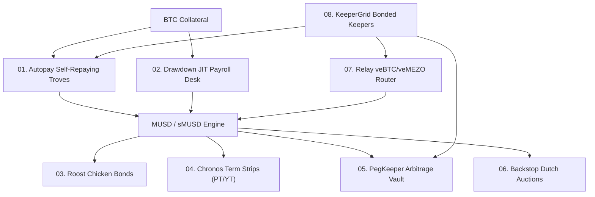

# MERIDIAN — Institutional BTCFi Pitch Deck

**Unified Liquidity, Credit & Yield Operating System on Mezo (Chain ID: 31611)**

---

## Slide 1: Title & Executive Summary
- **Protocol**: Meridian
- **Tagline**: The Autonomous Financial Layer for Bitcoin on Mezo
- **Mission**: Consolidate fragmented BTCFi primitives into a unified, self-repaying, capital-efficient liquidity stack.
- **Traction**: 13 verified smart contracts on Mezo Testnet, 85 unit & fuzz tests passed, 8 composable modules.

---

## Slide 2: The BTCFi Problem on Mezo
- **Fragmented Liquidity**: Borrowers, yield seekers, and governance voters operate in isolated silos.
- **Manual Trove Management**: Borrowers must manually monitor ICR or risk sudden liquidation in volatile markets.
- **Inefficient Yield Deployment**: sMUSD and Stability Pool yields sit idle instead of strengthening active debt positions.
- **Rigid Debt Markets**: Fixed-rate borrowing and predictable term financing do not exist on native BTC collateral.

---

## Slide 3: The Solution — Meridian's Four Pillars
1. **Credit & Streaming Payroll (Autopay + Drawdown)**:
   - Self-repaying TroveVaults automatically channel sMUSD yield to amortize debt and auto-compound Stability Pool BTC gains.
   - Just-in-time streaming payroll against corporate BTC collateral (zero idle borrowing costs).
2. **Fixed-Income & Yield Stripping (Roost + Chronos)**:
   - Hyperbolic Chicken Bonds (`bMUSD`) with 100% principal protection.
   - 30D / 90D / 180D Principal & Yield stripping (`PT / YT`) with uniform clearing batch rate auctions.
3. **Peg Defense & Liquidation Auctions (PegKeeper + Backstop)**:
   - Algorithmic MUSD peg defense through pooled hinted redemptions and Tigris swaps.
   - Stability Pool Dutch auction engine liquidating collateral from 100% down to 92% oracle floor.
4. **Governance & Bonded Automation (Relay + KeeperGrid)**:
   - Non-custodial veBTC / veMEZO voting autopilot guarded by BribeRadar malicious token detection.
   - Permissionless bonded keeper dispatch with 10% missed-window slashing.

---

## Slide 4: Architecture & Composability

---

## Slide 5: Core Value Proposition & Metrics
- **Capital Efficiency**: 100% of collateral yield is productively deployed to amortize debt or compound rewards.
- **Principal Protection**: Roost bonds allow 100% principal retrieval via chicken-out mechanism.
- **Predictable Borrowing**: Chronos locks in fixed borrow rates across standard quarterly maturities.
- **Network Resilience**: KeeperGrid aligns keeper economic incentives through staked sMUSD bond slashing.

---

## Slide 6: Verified Testnet Deployments (Chain 31611)
- `AutopayFactory`: `0x0EAA0e96974CBD3169B060c7C121165D91820078`
- `DrawdownDesk`: `0x0acaaD024c9d4729C6717B6429117d4aE66f9070`
- `ChickenBondManager`: `0x528ADC9Ae5A430D0a53f711661F18A8C5831CaF6`
- `ChronosTermVault`: `0x321C3673cCfDb5d5E259c86F4B2dB58Cc3a1eB64`
- `PegKeeperVault`: `0x8F569515fe8FB05177db0f039EA89a480C220e36`
- `BackstopVault`: `0x2FD13bf151587344C3505dD92439B68b9bf54642`
- `RelayVault`: `0x69c1f2EfBe79A1201CDaEE5a5F63024Ee374aF23`
- `KeeperGrid`: `0x61D0e6a90f7d0bCB75786E2a282f04Ff281F72C1`

---

## Slide 7: Roadmap
- **Q1 2027**: Full smart contract audit by Tier-1 security firm; live testnet keeper bot network.
- **Q2 2027**: Mezo Mainnet launch with conservative debt ceilings on Autopay, Roost, and PegKeeper.
- **Q3 2027**: Institutional liquidity routing, external AMM market maker integrations, and mobile dashboard.
